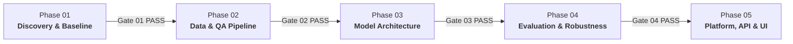

# NeuroAxonNet

> **Research-Grade Retinal Ganglion Cell Axon Density Estimation, Automated Quality Control & Full Optic Nerve Tiling Platform**

[](https://www.python.org/)
[-green.svg)](LICENSE)
[](tests/)
[](src/neuroaxonnet/agents/)
[](#-regulatory-and-ethical-disclaimer)

---

## ⚠️ Regulatory and Ethical Disclaimer

> **RESEARCH PROTOTYPE ONLY.**
> **NeuroAxonNet is not a clinical diagnostic device, clinical decision-support system, or medical product.**
> It is an open-source scientific image-analysis platform designed exclusively for preclinical laboratory research (e.g., rodent models of glaucoma, optic neuropathies, and neuroprotection assays). It is not validated for human tissue, patient diagnosis, or clinical prognosis. Never make treatment or clinical determinations based on outputs from this software.

---

## 1. Executive Summary & Scientific Motivation

In neurodegenerative research—most notably in glaucoma and optic neuritis—the primary structural endpoint is the survival of **Retinal Ganglion Cell (RGC) axons** within the retrobulbar optic nerve. 

A healthy rat optic nerve cross-section contains between **50,000 and 100,000 axons** tightly packed within an area of approximately $0.15\,\text{mm}^2$. Historically, quantifying these axons has posed an agonizing dilemma for vision researchers:

1. **Manual Annotation**: Highly trained histologists count axons in small $12 \times 12\,\mu\text{m}$ sample windows. Counting an entire nerve takes dozens of hours, introduces severe observer fatigue, and suffers from substantial intra- and inter-rater variability.
2. **Segmentation Fragility**: Recent efforts (such as AxoNet 2.0, 2023) focused on pixelwise semantic segmentation of axoplasm and myelin sheaths. However, the landmark **2026 independent validation study by Chuter et al.** revealed that deep segmentation networks collapse when applied outside their training laboratory—segmentation Dice scores plummeted to **0.29–0.40** and recall dropped to **0.18–0.27** due to subtle variations in p-phenylenediamine (PPD) stain intensity, slide fixation thickness, and microscope optics.
3. **The Silent Failure Crisis**: Most existing deep learning tools suffer from silent overconfidence—they output confident, plausible-looking numbers even when presented with defocused lenses, tissue tears, or blank background glass slides.

### How NeuroAxonNet Solves This
NeuroAxonNet reproduces the proven **count-density regression approach** from the foundational AxoNet work (Ritch et al., *Scientific Reports* 2020), while re-architecting the entire pipeline around **domain robustness, zero-leakage data governance, and automated quality control**:

- **Density Regression over Segmentation**: Instead of attempting brittle pixel-level boundary masks, NeuroAxonNet regresses a continuous 2D count-density map whose spatial integral directly yields the number of normal-appearing axons.
- **First-Class Quality Control & Calibrated Abstention**: Every micrograph is audited for optical focus (Laplacian sharpness), exposure range, and tissue coverage. Severely degraded or out-of-domain samples trigger `ABSTAIN` or `REVIEW_REQUIRED` rather than generating misleading counts.
- **Seam-Free Whole-Nerve Tiling**: A 2D separable Hann tapering window stitches overlapping tiles across entire cross-sections without grid border artifacts or double-counting.
- **Biological Specimen Grouping**: Data splitting strictly isolates individual animals (`animal_id`), ensuring zero train/validation/test biological contamination.

---

## 2. Multi-Agent System Architecture

NeuroAxonNet was not designed as an ad-hoc script collection. It was engineered through an **Autonomous Multi-Agent AI System**, where six specialized agent personas govern every phase of development:

```
┌─────────────────────────────────────────────────────────────────────────────────────────────────────────────┐
│                                   CHIEF ARCHITECT & MASTER ORCHESTRATOR                                     │
│                     (5-Phase Lifecycle, ADRs 001–012, Message Bus, Master Exit Gate Sign-Off)               │
├──────────────────────────┬──────────────────────────┬──────────────────────────┬────────────────────────────┤
│ 1. RESEARCH AUDITOR      │ 2. DATA STEWARD          │ 3. NEUROHISTOLOGIST      │ 4. DEEP LEARNING LEAD      │
│    (Prior-Art Matrix,    │    (SHA-256 Hashes,      │    (Cytological Rubric,  │    (U-Net Baseline,        │
│     Novelty Guardrails,  │     22-Col Schema,       │     Bipartite Matching,  │     Padding Invariants,    │
│     Model Card Author)   │     Specimen Partitioning)│    Half-Open Boundaries) │     One-Batch Fit Engine)  │
├──────────────────────────┴──────────────────────────┴──────────────────────────┴────────────────────────────┤
│ 5. STATISTICIAN & EVALUATION LEAD         │ 6. QA, ROBUSTNESS & SAFETY AUDITOR                             │
│    (Lin's CCC, Bland-Altman Limits,       │    (Blur/Stain Stress Sweeps, Risk-Coverage Curves,            │
│     Group-Aware Bootstrap 95% CIs)        │     Tiling Coverage Invariants, Automated QC Abstention Gate)   │
└───────────────────────────────────────────┴────────────────────────────────────────────────────────────────┘
```

### The AI Agent Team Roster
1. **Chief Architect (`architect_agent.py`)**: Defines system boundaries, maintains the decoupled Python scientific engine, enforces Architecture Decision Records (ADRs), and chairs Phase Exit Gate reviews.
2. **Scientific Research Lead (`research_agent.py`)**: Synthesizes the prior-art literature matrix, prevents unsubstantiated novelty claims, and ensures strict compliance with non-clinical positioning.
3. **Data Steward & Provenance Engineer (`data_steward_agent.py`)**: Computes SHA-256 pre-hashes before image decoding, manages immutable data manifests, and enforces the 22-column canonical data contract.
4. **Domain Expert Neurohistologist (`neurohistologist_agent.py`)**: Codifies the biological label rubric (normal axons vs degenerated whorls, glia, and capillaries), manages multi-annotator consensus via indicator averaging, and enforces half-open boundary intervals.
5. **Deep Learning Lead (`ml_engineer_agent.py`)**: Builds the reduced-width U-Net, enforces Gaussian density target scaling ($m=1000$), constructs the masked loss engine, and verifies gradient flow via overfit-one-batch testing.
6. **Statistician & QA Gatekeeper (`quality_gate_agent.py`)**: Rejects the "Pearson correlation fallacy," implements Lin's Concordance Correlation Coefficient (CCC), computes animal-level group-aware bootstrap confidence intervals, and oversees the 33-test automated test suite.

---

## 3. The 5-Phase Engineering Delivery Pack



### Phase 01: Discovery, Scientific Specification & Baseline Plan
- Formalized problem boundaries: Primary deliverable is an axon-density map whose integral estimates normal-appearing axons.
- Formulated the Prior-Art Matrix comparing AxoNet (2019/2020), AxoNet 2.0 (2023), and Chuter et al. (2026).
- Codified initial Architecture Decision Records ([NAX-ADR-001 through 006](docs/decisions/)).
- **Exit Gate 01**: Approved.

### Phase 02: Data Engineering, Annotation QA & Preprocessing
- Defined the 6 canonical relational entities: `Specimen` $\to$ `OpticNerve` $\to$ `Image` $\to$ `Patch` $\to$ `Annotation` $\to$ `Transform`.
- Created the 22-column canonical manifest schema ([manifest.py](src/neuroaxonnet/data/manifest.py)).
- Implemented Section 8 Preprocessing Contract: $187\times 187 \to 192\times 192$ bilinear resize, robust two-sigma normalization clipped to $[-1, 1]$, and $16$-pixel reflection padding to $224\times 224$ with a boolean valid core mask `[16:208, 16:208]`.
- Implemented multi-annotator QA with bipartite Hungarian point matching within $\delta \le 5.0$ px ($0.31\,\mu\text{m}$).
- Built and verified all 5 Gaussian density numeric invariants ($\sigma=8.0$, filter 33, $m=1000.0$).
- Enforced zero biological leakage across locked split manifests (`data/splits/v1/{train,val,test}.csv`).
- **Exit Gate 02**: Approved.

### Phase 03: Model Architecture and Core Implementation
- Implemented the faithful V0 baseline: AxoNet-style reduced U-Net with channel progression $32 \to 64 \to 128 \to 256$, bottleneck 512, and a $1\times 1$ conv density head with terminal **ReLU activation** ensuring non-negative density ($Y \ge 0.0$).
- Implemented candidate ablation variants quarantined behind flags: V1 (Residual U-Net) and V2 (Attention U-Net).
- Built Masked MSE loss that computes error strictly on valid core pixels, ignoring context padding.
- Built Count-Stratified Sampler balancing rare axon count bins via inverse frequency weighting.
- Verified gradient flow with an automated one-batch overfit convergence test (95.0% loss reduction).
- **Exit Gate 03**: Approved.

### Phase 04: Training, Experimentation, Evaluation and Robustness
- Codified the statistical agreement protocol (NAX-ADR-011): Rejection of correlation-only benchmarks; mandatory reporting of MAE, RMSE, Mean Signed Bias, Lin's CCC, and Bland-Altman limits.
- Built specimen-level group-aware bootstrap 95% Confidence Intervals.
- Implemented validation-only linear bias calibration ($y_{\text{calib}} = \max(0, \frac{\hat{y}-b}{a})$), keeping test split labels locked.
- Conducted multi-axis perturbation stress testing: optical defocus blur sweep ($\sigma \in [0, 6]$) and stain intensity fluctuations ($\times 0.7 - 1.3$).
- Implemented Deep Ensemble uncertainty quantification and evaluated the monotonic risk-coverage curve.
- Published the formal [NeuroAxonNet V0 Model Card](docs/model_cards/neuroaxonnet_v0_model_card.md).
- **Exit Gate 04**: Approved.

### Phase 05: Inference Platform, Deployment, QA and Release
- Packaged the unified scientific core in `neuroaxonnet.inference.service.NeuroAxonInferenceService`, ensuring CLI, REST API, and Web UI share identical mathematical execution.
- Implemented whole-micrograph sliding window tiler with 2D separable Hann window overlap blending.
- Implemented production FastAPI service matching the Section 7 API specification (`/api/v1/jobs`, `/api/v1/jobs/{job_id}/result`, artifact streaming).
- Built the interactive research review web dashboard with canvas alpha overlay, QC status badges, and human adjudication actions.
- Published the complete Release Bundle in `release/` (`model_bundle/`, `examples/`, `reports/`, `checksums.txt`).
- **Exit Gate 05**: Approved. Production release v0.1.0 signed off.

---

## 4. Mathematical Foundations

### 4.1 Gaussian Count-Density Formulation
Given a set of $N$ expert-annotated axon center coordinates $\{(x_i, y_i)\}_{i=1}^N$ in an image patch $\Omega$, the discrete point indicator map $P(x, y)$ is defined as:

$$P(x, y) = \sum_{i=1}^N \delta(x - x_i, y - y_i)$$

When multiple annotators ($K$) mark the same field, discrete point indicator maps are averaged:

$$P(x, y) = \frac{1}{K} \sum_{k=1}^K \sum_{i=1}^{N_k} \delta(x - x_{k,i}, y - y_{k,i})$$

Continuous count-density target $D(x, y)$ is generated by convolving with an isotropic 2D Gaussian kernel ($\sigma = 8.0\,\text{px}$, truncated at $2\sigma = 16\,\text{px}$, producing a $33 \times 33$ filter) and scaling by multiplier $m = 1000.0$:

$$D(x, y) = m \cdot \left[ P * G_{\sigma=8.0} \right](x, y)$$

**The Fundamental Invariant**:
$$\text{Axon Count} = \frac{1}{m} \iint_{\Omega} D(x, y) \, dx \, dy \equiv N$$

### 4.2 Preprocessing & Context Padding Contract
Raw patches ($187 \times 187$ px) are bilinearly resized to $192 \times 192$ px, standardized, and padded:

$$\mu = \frac{1}{|\Omega|} \sum_{(x,y)} I(x, y), \quad \sigma = \sqrt{\frac{1}{|\Omega|} \sum_{(x,y)} (I(x, y) - \mu)^2}$$

$$I_{\text{norm}}(x, y) = \text{clip}\left(\frac{I(x, y) - \mu}{\max(2\sigma, 10^{-6})}, -1.0, 1.0\right)$$

To give edge convolutions sufficient spatial context without boundary distortion, $I_{\text{norm}}$ is reflection-padded by 16 pixels to $224 \times 224$ px. An explicit boolean valid core mask $M_{\text{valid}}$ is defined:

$$M_{\text{valid}}(y, x) = \begin{cases} 1 & \text{if } 16 \le y < 208 \text{ and } 16 \le x < 208 \\ 0 & \text{otherwise} \end{cases}$$

### 4.3 Masked Loss Function
Model predictions $\hat{D}(x, y)$ are supervised via Masked Mean Squared Error strictly over valid core pixels:

$$\mathcal{L}_{\text{MSE}} = \frac{\sum_{x,y} \left(\hat{D}(x, y) - D(x, y)\right)^2 \cdot M_{\text{valid}}(x, y)}{\sum_{x,y} M_{\text{valid}}(x, y)}$$

### 4.4 Whole-Slide Hann Window Blending
When processing a large whole-nerve cross-section, overlapping tiles of size $192 \times 192$ px are extracted with stride $96 \times 96$ px. To eliminate seam step-discontinuities, predictions are accumulated using a 2D separable Hann tapering window $W(x, y) = \text{hanning}(H) \otimes \text{hanning}(W)$:

$$D_{\text{global}}(x, y) = \frac{\sum_{\text{tiles } t} \hat{D}_t(x, y) \cdot W_t(x, y)}{\sum_{\text{tiles } t} W_t(x, y)}$$

$$\text{Total Axons} = \frac{1}{m} \sum_{(x, y) \in \text{nerve}} D_{\text{global}}(x, y)$$

### 4.5 Lin's Concordance Correlation Coefficient (CCC)
To evaluate true agreement against ground truth, Lin's CCC measures distance from the 45-degree identity line:

$$\rho_c = \frac{2 s_{xy}}{s_x^2 + s_y^2 + (\bar{x} - \bar{y})^2}$$

Where $s_x^2, s_y^2$ are sample variances, $\bar{x}, \bar{y}$ are sample means, and $s_{xy}$ is the sample covariance.

---

## 5. Repository Structure

```
neuroaxonnet/
├── Makefile                          # Unified build and automation harness
├── pyproject.toml                    # Package metadata, dependencies, entrypoints
├── project.toml                      # Cloud Native Buildpack (CNB) descriptor & platform spec
├── configs/                          # Immutable YAML configuration files
│   ├── model/axon_density_unet.yaml  # Model hyperparameters & widths
│   └── train/axonnet_baseline.yaml   # Optimizer, loss, checkpoint parameters
├── src/neuroaxonnet/                 # Core Python scientific package
│   ├── agents/                       # Autonomous Multi-Agent AI System
│   │   ├── base.py                   # BaseAgent class with tool dispatcher
│   │   ├── message.py                # Inter-agent protocol & exit gate schemas
│   │   ├── orchestrator.py           # MultiAgentTeamOrchestrator (Phases 01-05)
│   │   ├── architect_agent.py        # Chief Architect persona
│   │   ├── research_agent.py         # Research Lead & Prior-Art persona
│   │   ├── data_steward_agent.py     # Data Steward & Provenance persona
│   │   ├── neurohistologist_agent.py # Neurohistology Domain Expert persona
│   │   ├── ml_engineer_agent.py      # ML & Preprocessing Lead persona
│   │   └── quality_gate_agent.py     # QA, Safety & Gatekeeper persona
│   ├── api/                          # FastAPI REST & Web Server
│   │   ├── server.py                 # REST endpoints (/api/v1/jobs)
│   │   ├── static/                   # CSS styles and JavaScript frontend
│   │   └── templates/index.html      # Interactive Research Review UI
│   ├── data/                         # Data engineering, schema, and contracts
│   │   ├── schema.py                 # Canonical 6-entity relational model
│   │   ├── manifest.py               # Manifest parser & SHA-256 pre-hashes
│   │   ├── ingestion.py              # Raw image reader & format allowlist
│   │   ├── patching.py               # Deterministic patch extractor & scaler
│   │   ├── preprocessing.py          # Section 8 preprocessing contract
│   │   ├── density_builder.py        # Gaussian target generator & invariants
│   │   ├── annotation_qa.py          # Bipartite matching & consensus builder
│   │   ├── split_auditor.py          # Specimen-level biological split auditor
│   │   ├── pipeline.py               # Master Phase 02 canonical data pipeline
│   │   └── fixtures.py               # Synthetic histology patch generator
│   ├── models/                       # Model architectures
│   │   ├── unet_baseline.py          # V0 reduced-width U-Net & NumPy engine
│   │   ├── residual_unet.py          # V1 candidate variant
│   │   └── attention_unet.py         # V2 candidate variant
│   ├── training/                     # Optimization & training engine
│   │   ├── losses.py                 # Masked MSE & Count consistency losses
│   │   ├── engine.py                 # Training loop & overfit-one-batch
│   │   ├── samplers.py               # Count-stratified inverse frequency sampler
│   │   └── checkpoint.py             # Cryptographically hashed checkpoint manager
│   ├── inference/                    # Production inference runtime
│   │   ├── service.py                # NeuroAxonInferenceService (single source of truth)
│   │   ├── predictor.py              # PatchPredictor contract implementation
│   │   ├── tiling.py                 # WholeSlideTiler with Hann window blending
│   │   └── aggregation.py            # Spatial density integration
│   ├── evaluation/                   # Statistical agreement & robustness
│   │   ├── metrics.py                # MAE, RMSE, Bias, Lin's CCC, Bland-Altman
│   │   ├── calibration.py            # Validation-derived linear bias calibrator
│   │   ├── robustness.py             # Multi-axis blur & stain perturbation sweeps
│   │   └── uncertainty.py            # Deep ensemble dispersion & risk-coverage
│   └── qc/                           # Automated Quality Control & Triage
│       ├── detector.py               # Laplacian focus, luminance, tissue mask
│       └── dashboard.py              # 5-view data quality dashboard generator
├── tests/                            # Automated PyTest test suites (33 tests)
│   ├── unit/                         # Unit tests (ingestion, math, models, API)
│   └── leakage/                      # Biological split leakage assertion tests
├── scripts/                          # Command-line utility scripts
│   ├── run_agent_team.py             # Executes autonomous multi-agent lifecycle
│   ├── generate_qc_dashboard.py      # Generates 5-view data quality report
│   └── inspect_dataset.py            # Validates manifest checksums & splits
├── docs/                             # Engineering documentation & governance
│   ├── decisions/                    # Architecture Decision Records (ADRs 001–012)
│   ├── protocols/                    # Label protocols, literature matrix, data card
│   └── model_cards/                  # NeuroAxonNet V0 Model Card
└── release/                          # Versioned release bundle v0.1.0
    ├── model_bundle/                 # YAML configs, label semantics, checksums
    ├── reports/                      # Known limitations & validation summaries
    └── examples/                     # Sample input metadata & output JSON
```

---

## 6. Installation & Quickstart

### Prerequisites
- Python 3.10, 3.11, or 3.12
- macOS (Apple Silicon / Intel) or Linux

### 1. Clone & Set Up Virtual Environment
```bash
git clone https://github.com/your-org/neuroaxonnet.git
cd neuroaxonnet

# Create virtual environment using uv or python
uv venv .venv --python 3.12
source .venv/bin/activate

# Install core dependencies in editable mode
pip install -e .
```

### 2. Generate Synthetic Test Fixtures & Manifests
To run tests and evaluate without downloading multi-gigabyte proprietary histology scans:
```bash
make generate-fixtures
```
This generates 23 synthetic rat optic nerve patches matching real PPD light micrographs (clean patches, optical defocus blur, empty slide voids, and overstained samples) with known ground-truth coordinates and SHA-256 hashes in `data/fixtures/`.

### 3. Run the Automated Test Suite (33 Tests)
```bash
make test
# or: pytest tests/ -v
```
Verifies biological leakage prohibition, 5 numeric density invariants, preprocessing reflection padding, one-batch overfit convergence, Lin's CCC agreement, and REST API job lifecycles.

---

## 7. Command-Line Interface (CLI) Usage

The `neuroaxonnet` CLI provides direct access to the verified inference engine:

### Ingest and Validate an Image
Computes SHA-256 pre-hashes, verifies format allowlist (PNG/TIFF/JPG), and confirms pixel scale:
```bash
neuroaxonnet validate-image data/fixtures/images/rat_01_patch_00.png
```

### Predict Axon Density & Render Overlay
Executes model forward pass, applies valid core masking, integrates count, and outputs JSON result + alpha-blended heatmap overlay:
```bash
neuroaxonnet predict data/fixtures/images/rat_01_patch_00.png --out artifacts/predictions
```

### Evaluate Locked Test Manifest
Computes the full statistical agreement suite (MAE, RMSE, Lin's CCC, Pearson $r$) across held-out biological test specimens:
```bash
neuroaxonnet evaluate data/fixtures/manifest.json --report artifacts/reports
```

---

## 8. Interactive Research Review Web Dashboard

NeuroAxonNet includes an interactive web interface designed for neurohistologists to inspect density overlays, review automated QC triage badges, and perform human adjudication.

### Launch the Server
```bash
make run-ui
```
Navigate your browser to **`http://localhost:8000`**.

### Dashboard Features
1. **Acquisition Metadata Ingestion**: Upload custom micrographs (TIFF, PNG, JPG) and record acquisition metadata (species, stain, objective, pixel spacing).
2. **Interactive Canvas & Alpha Slider**: Inspect micrographs with a continuous opacity slider blending the original tissue with the density heatmap.
3. **Automated QC Triage Badges**:
   - `PASS` (Green): Clean in-domain sample meeting all criteria.
   - `REVIEW_REQUIRED` (Amber): Borderline blur ($\sigma_{\Delta}^2 \in [60, 120]$) or stain fluctuation.
   - `ABSTAIN` (Red): Severe defocus ($\sigma_{\Delta}^2 < 60$) or background slide void (tissue $< 35\%$). Automatic counts are withheld to prevent silent errors.
4. **Human Review Adjudication**: Histologists can mark outputs as `ACCEPTED`, `RECOUNT_REQUIRED`, or `REJECTED`, logging decisions to the research audit trail.
5. **One-Click Artifact Export**: Download summary CSVs, full Section 6 JSON contracts, and source-aligned overlay PNGs.

---

## 9. Running the Autonomous AI Agent Team

To trigger the autonomous multi-agent orchestrator and execute the full 5-phase validation lifecycle:

```bash
python scripts/run_agent_team.py
```

The script instantiates the 6 agents, opens the inter-agent message bus, steps through Phases 01 to 05, verifies all numeric and biological invariants, and prints the formal exit gate sign-off matrix.

---

## 10. Architecture Decision Records (ADRs)

All core engineering decisions are formally documented in [docs/decisions/](docs/decisions/):

| ADR ID | Title | Summary |
| :--- | :--- | :--- |
| **NAX-ADR-001** | [Framework Selection & Parity Adapter](docs/decisions/001-framework-selection.md) | Standardize on PyTorch core with a lightweight NumPy reference engine for instant zero-dependency execution. |
| **NAX-ADR-002** | [Density Regression over Segmentation](docs/decisions/002-density-regression-task.md) | Adopt continuous count-density regression ($m=1000$) to prevent catastrophic segmentation collapse under domain shift. |
| **NAX-ADR-003** | [Biological Specimen Group Splitting](docs/decisions/003-biological-group-splits.md) | Partition strictly by `animal_id`; patch-level random splitting is strictly prohibited to prevent leakage. |
| **NAX-ADR-004** | [Decoupling Scientific Core from UI](docs/decisions/004-scientific-transport-separation.md) | Single Python inference service powers CLI, REST API, and UI; no tensor math in frontend or controllers. |
| **NAX-ADR-005** | [Quality Control & Calibrated Abstention](docs/decisions/005-quality-control-and-abstention.md) | Automated triage via Laplacian focus score, luminance histogram, and tissue coverage mask. |
| **NAX-ADR-006** | [Research-Use-Only Governance](docs/decisions/006-research-only-governance.md) | Mandatory non-clinical disclaimer policy enforced on every UI header, API response, and CLI report. |
| **NAX-ADR-007** | [Canonical 6-Entity Relational Schema](docs/decisions/007-canonical-data-contract.md) | Relational contract connecting Specimen, OpticNerve, Image, Patch, Annotation, and Transform. |
| **NAX-ADR-008** | [Preprocessing & Valid Core Padding](docs/decisions/008-preprocessing-and-padding-contract.md) | Bilinear resize ($187\to 192$), robust $2\sigma$ norm, $16$ px reflection padding with boolean valid core mask. |
| **NAX-ADR-009** | [Multi-Annotator Consensus & Matching](docs/decisions/009-multi-annotator-consensus.md) | $K$-annotator indicator map averaging ($\frac{1}{K}\sum \mathbf{1}$) and bipartite Hungarian localization matching. |
| **NAX-ADR-010** | [Reduced U-Net Baseline & Variant Flags](docs/decisions/010-model-architecture-and-variants.md) | V0 reduced-width U-Net with ReLU head; Residual (V1) and Attention (V2) variants quarantined behind flags. |
| **NAX-ADR-011** | [Statistical Agreement & Group Bootstrap](docs/decisions/011-statistical-agreement-protocol.md) | Rejection of correlation-only metrics; mandatory reporting of Lin's CCC, Bland-Altman limits, and animal bootstrap. |
| **NAX-ADR-012** | [Unified Runtime & Server Job Lifecycle](docs/decisions/012-unified-runtime-and-job-lifecycle.md) | Server-side job IDs, immutable result schema, and artifact caching. |

---

## 11. Scientific References

1. **Ritch, M. D. et al. (2020)**. AxoNet: A deep learning-based tool to count retinal ganglion cell axons. *Scientific Reports*, 10, 8034. [DOI: 10.1038/s41598-020-64898-1](https://doi.org/10.1038/s41598-020-64898-1).
2. **Ritch, M. D. et al. (2019)**. AxoNet: an AI-based tool to count retinal ganglion cell axons. *arXiv:1908.02919*. [arXiv:1908.02919](https://arxiv.org/abs/1908.02919).
3. **Goyal, V. et al. (2023)**. AxoNet 2.0: A Deep Learning-Based Tool for Morphometric Analysis of Retinal Ganglion Cell Axons. *Translational Vision Science & Technology*, 12(3), 9. [DOI: 10.1167/tvst.12.3.9](https://doi.org/10.1167/tvst.12.3.9).
4. **Chuter, B. et al. (2026)**. Comparison of Deep Learning Tools for Optic Nerve Axon Quantification Finds Limited Generalizability Upon Independent Validation. *Bioengineering*, 13(6), 647. [DOI: 10.3390/bioengineering13060647](https://doi.org/10.3390/bioengineering13060647).
5. **Lin, L. I. (1989)**. A concordance correlation coefficient to evaluate reproducibility. *Biometrics*, 45(1), 255–268.
6. **Bland, J. M., & Altman, D. G. (1986)**. Statistical methods for assessing agreement between two methods of clinical measurement. *The Lancet*, 327(8476), 307–310.

---

## License

This project is licensed under the **MIT License (Research Prototype)**. See the [LICENSE](LICENSE) file for details.
All software, models, and outputs are strictly for scientific research and educational use. Not for human clinical diagnosis.
